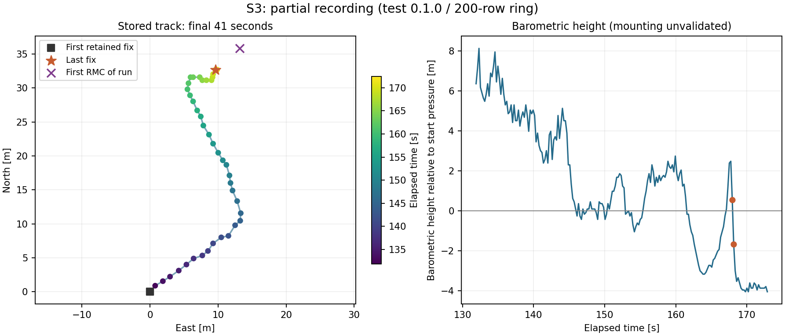

# S3: GPS und Barometer gemeinsam, Eingang 2026-10-20

## Ergebnis und Nachweisgrenze

**S3 ist als gemeinsamer Sensorfunktionstest bestanden.** Der Besitzer meldet
den Weg Sueden eben, Westen bergauf, Osten bergab, Norden eben und hat den Lauf
selbst beendet. Das JSON bestaetigt `keyboard_interrupt`, `shutdown_ok=true`
und keine protokollierten Sensorfehler. GPS und Barometer lieferten gemeinsam
Daten. Das ist kein Test des MANUAL-/STABILIZE-Regelkreises.

**Dieser Lauf nutzte noch Sensor-Test 0.1.0 / Schema 1 mit 200-Zeilen-Ring.**
Von 841 erfassten Zeilen wurden nur die letzten 200 exportiert. Die neue
vollstaendige RAM-Aufzeichnung aus Sensor-Test 0.2.0 ist damit noch nicht auf
dem MCU bestaetigt. Weder freier Flashplatz noch das Loeschen alter Dateien
veraendern die Kapazitaet dieses alten RAM-Rings. Die Ursache fuer den alten
Dateistand bzw. einen moeglichen Importcache laesst sich nicht feststellen.

## Verifizierte Logbefunde

| Merkmal | Ergebnis |
| --- | --- |
| Laufdauer | 172.972 s; manuell beendet, nicht durch einen Sensorfehler |
| Profil / Steuerungsbasis | both / 0.2.3-bench |
| Gespeichertes CSV-Fenster | 131.910 bis 172.873 s, also 40.963 s |
| Struktur | 200 Zeilen, 25 Spalten, streng aufsteigende Zeitstempel |
| GPS | 1969 pruefsummengueltige NMEA-Saetze, 346 GGA/RMC-Updates |
| Empfangsfehler | 0 checksum_errors, parse_errors, poll_gaps, overlong, resyncs |
| Fixzaehler | 173 GGA- und 173 RMC-Fixsaetze; erster gepaarter Fix bei 0.461 s |
| Satelliten | Maximum 12; im gesamten CSV 12 benutzte Satelliten |
| Gepaarte GPS-Samples im CSV | 177 von 200; GGA und RMC jeweils in allen 200 frisch/gueltig |
| Barometer | 1671 Messungen, Adresse 0x77, Startdruck 95599.95 Pa |
| Barometer im CSV | Alle 200 gueltig; Alter 0 bis 94 ms |
| Druck / Sensortemperatur im CSV | 95508 bis 95646 Pa / 12.39 bis 12.96 Grad C |
| Relative Hoehe im CSV | -4.06 bis +8.12 m zum Startdruck |
| Sensorstarter work | Mittel 3.306 ms, Maximum 42.976 ms; kein >50-ms-Ereignis |
| Sensorstarter period | Mittel 10.549 ms, Maximum 43.529 ms; etwa 94.80 Hz |

Die 23 nicht gepaarten GPS-Samples sind keine 23 belegten Empfangsausfaelle:
Der Parser verlangt fuer `gps_valid` frische GGA und RMC derselben UTC-Epoche.
Zwischen deren Eintreffen kann die Paarung voruebergehend fehlen, obwohl beide
einzelnen Saetze frisch sind. Es wurden keine Pollpausen protokolliert.

Die 0.461 s bis zum ersten Fix belegen keinen allgemeinen Kaltstartwert; das
GPS kann bereits zuvor versorgt gewesen sein. Diese Laufzeiten gelten nur
fuer den Sensorstarter, nicht fuer den Controller mit IMU, RC und Servoausgabe.

## Passt der Weg zur Beschreibung?

Nur der letzte Wegabschnitt ist gespeichert. Vom ersten zum letzten
gespeicherten GPS-Punkt sind es etwa **9.6 m nach Osten und 32.7 m nach Norden**.
Der Anfang dieses Ausschnitts verlaeuft nach Osten/Nordosten und die
Barometerhoehe sinkt dabei; das passt zu einem Teil des beschriebenen
Ost-/Bergabwegs. Danach dominiert eine Bewegung nach Norden.

Der Suedweg und der westliche Anstieg liegen nicht vollstaendig im CSV.
Das JSON bewahrt allerdings den ersten gueltigen RMC-Satz des Laufs separat.
Gegenueber diesem ersten Fix liegt der letzte Punkt etwa 3.6 m westlich und
3.1 m suedlich, insgesamt **rund 4.7 m entfernt**. Das passt zu einer Rueckkehr
in die Naehe des Ausgangspunkts. Es ist kein vermessener Schliessfehler:
Die gesamte Runde und absolute Positions-/Hoehengenauigkeit sind nicht
bestaetigbar. Die Besitzerbeobachtung wird als solche uebernommen, nicht durch
fehlende Daten ersetzt.

Der Weg ist relativ zum ersten behaltenen CSV-Punkt dargestellt. Das Kreuz
zeigt den separaten ersten RMC-Fix; die fehlenden Streckenteile werden nicht
durch eine Verbindung zu diesem Punkt erfunden.

## Hoehenanzeige: brauchbarer Datenpfad, noch kein validiertes Vario

Alle gespeicherten D1/D2-Rohwerte ergeben mit den gespeicherten PROM-Werten
erneut exakt den protokollierten ganzzahligen Druck und die Temperatur.
Die relative Hoehe stimmt mit der Druckformel innerhalb rund 0.008 m ueberein
(Rundung/Arithmetik). Ein Kompensations- oder CSV-Rechenfehler ist hier nicht
sichtbar.

Es gibt trotzdem deutliche Druck-/Hoehenschwankungen: von 167.942 auf 168.143 s
faellt die Anzeige **0.53 auf -1.68 m**, also 2.21 m in 0.201 s. Das ist fuer
den als eben beschriebenen Gehabschnitt keine bestaetigte reale Vertikalbewegung.
Wind/Staudruck, Handhabung, Temperatur oder die konkrete Montage sind moegliche
Einfluesse; die Dateien beweisen keine dieser Ursachen. Nicht durch ein neues
Filter oder Reglergain auf Verdacht verdecken. Im endgueltigen, beluefteten
Rumpfeinbau ruhig liegen lassen und gezielt anheben/absenken; Druckoeffnung
vor direkter Anstroemung schuetzen, ohne sie luftdicht zu verschliessen.

Auch die GPS-Hoehe ist hier kein Hoehenreferenznachweis: erster separat
gespeicherter GGA-Satz 480.6 m MSL, letzter CSV-Fix 498.5 m MSL, also 17.9 m
Unterschied trotz horizontaler Rueckkehr in Startnaehe. Weder eine reale
Hoehendifferenz noch deren genaue Ursache ist damit belegt. GPS-MSL-Hoehe und
relative Barometerhoehe haben zudem verschiedene Bezugspunkte.

## Naechster Schritt

1. Sensorabschluss auf codex/gps-baro-bringup nach Besitzerfreigabe committen.
2. MANUAL-Fluglogger auf neuem codex/manual-flight-logger vom Abschlusscommit
   entwickeln; main muss dafuer nicht vorzeitig zusammengefuehrt werden.
3. Beim naechsten Bodenlauf alle sechs Sensormodule konsistent hochladen,
   calibration.json erhalten, Soft-Reboot, Version 0.2.0 sowie JSON-Schema 2
   pruefen. Anfang und Ende sowie `all_samples_retained` kontrollieren.
   Keine weitere vollstaendige Huegelrunde allein dafuer erforderlich.
4. Einbau, endgueltige IMU-Ausrichtung, Bordversorgung und Logabschluss gemaess
   [Einbau-/MANUAL-Plan](../../EINBAU_UND_MANUAL_DATENFLUG.md) vorbereiten.

## Unveraenderte Rohdaten

- [CSV](sensors_2344143_0.csv), SHA-256:
  `dfd176fc859bf2445a84155752465e883e073f24b6df608690360f5c75c610d4`
- [JSON](sensors_2344143_0.json), SHA-256:
  `60433c0e7257fba35be7aa7c69d437dd7c3993dcfb21f6be0e7c4f80ed532fa1`

Hostpruefung: Metadaten/CSV abgeglichen, Zeiten/Flags/Wertebereiche ausgewertet,
MS5611-Kompensation und relative Hoehe aus Rohwerten nachgerechnet. Rohdateien
nicht bearbeitet. Die ausgewaehlten Dateien sind gezielt von den allgemeinen
Sensorlog-Ignore-Regeln ausgenommen und fuer den Ergebniscommit vorgesehen.
