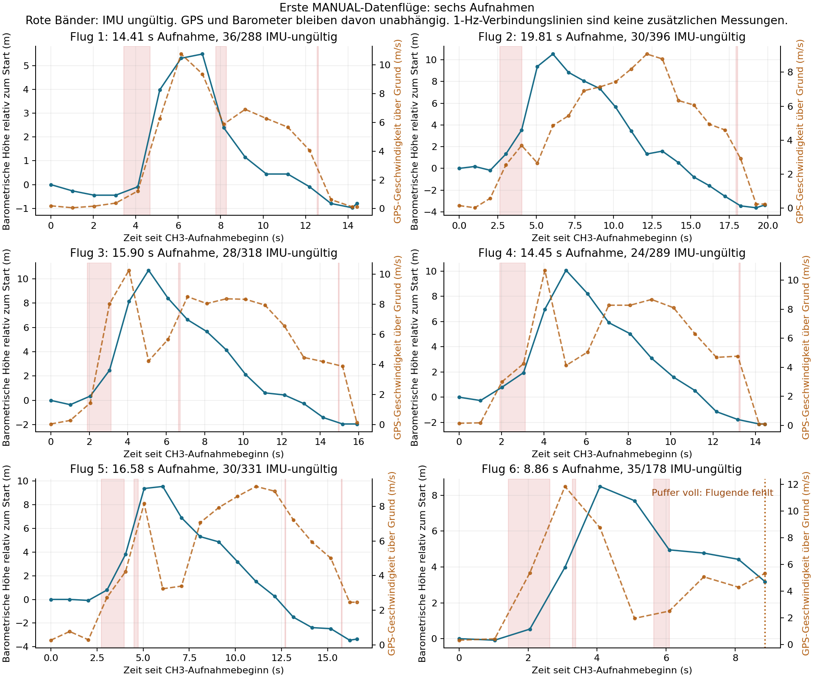
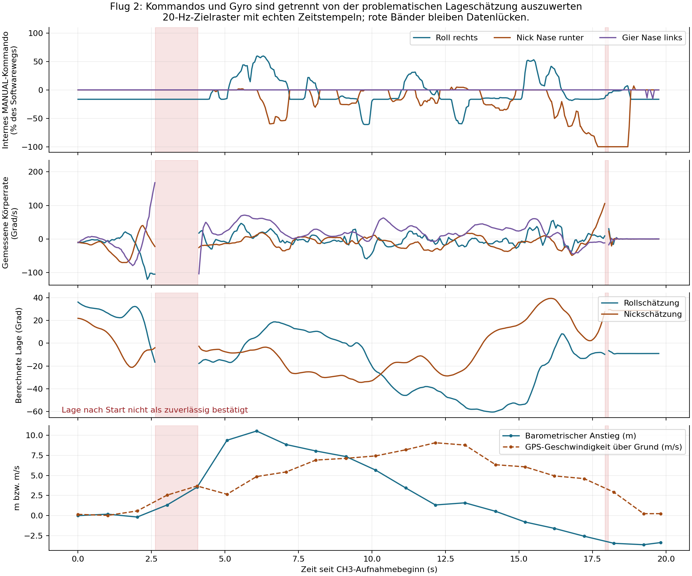

# Erste MANUAL-Datenfluege: brauchbare Rohsignale, verlorene Lageschaetzung

Auswertung2026-10-27 von flight_868672_0.json, .csv und _response.csv.
Branch codex/manual-flight-tests-20hz. Keine Firmwareaenderung aus dieser
Auswertung; Rohdateien unveraendert. Dies sind echte Fluege, keine Tischtests.

## Besitzerangaben und Grenzen der Dokumentation

- Jedes der sechs Aufnahmesegmente entspricht einem Flug mit Discusstart.
  Keine besonderen Testmanoever, da wenig Flugzeit verfuegbar war. Der Besitzer
  konnte das Modell jeweils steuern und stabil halten.
- Leichter Westwind auf einer beschatteten Hangseite im Lee. Wind/Guststaerke
  nicht gemessen; keine ruhige Referenzluft voraussetzen.
- Schwererer BEC vorne, geschaetzt etwa22 g Gesamtgewicht des BEC,22 g
  Gegengewicht hinten, laut Besitzer zum Erhalten des Schwerpunkts. Gesamtmasse,
  alte BEC-Masse und genaue Schwerpunktposition unbekannt. Daraus nicht44 g
  Mehrgewicht gegenueber der alten Konfiguration errechnen.
- Quer wurde nach dem Einschalten bewusst am Sender getrimmt. Das passt zum
  wiederholten Anfangskommando von1538 us, etwa38 us ueber Softwaremitte bzw.
  -16.5 % internem Rollkommando. Die gespeicherte RC-Mitte bleibt unveraendert.
- Ein erster Export gelang. Ein zweiter Lauf zeigte nach Orange beim Stop
  Rot und wurde danach ausgeschaltet; dessen RAM-Daten sind damit verloren.
  Hier liegen nur die drei Dateien des ersten Exports vor. Keine genaue
  Fehlermeldung oder Messung des damals freien Flash verfuegbar.

Ruderstand im JSON: Quer/Hoehe/Seite limit230/400/350 us, center1500,
trim0, RX-/Servozeichen-1. Gemeldete mechanische Wege13/12/19..20 mm.
Ein exakter geflogener Git-Commit wird im Report nicht gespeichert. Loggerbasis
ist0.2.0; fuer den tatsaechlichen Boardstand gelten die Konfigurations-/
Kalibriersnapshots im JSON, einschliesslich der damaligen Besitzeranpassungen.
IMU-Mapping(-1,-1,1) und gespeicherte Levelreferenz/Accelkorrektur passen
zusammen. Das ist Konfigurationskonsistenz, keine Vermessung der Montage.

## Vollstaendigkeit und Steuerkontinuitaet

| Merkmal | Beleg |
| --- | --- |
| Logger / Einstieg | 0.2.0, response20, boot_button, MANUAL |
| Gesamtlauf | 817.961 s =13 min37.961 s |
| Aufnahme insgesamt | 90.021 s in sechs Segmenten |
| Schneller Strom | 1800 Zeilen, Sequenz0..1799, Puffer voll |
| Vollsnapshot | 98 Zeilen:86 periodische Samples und12 Ereignisse |
| Schnelle Rate | 19.9895 Hz, mittlerer Abstand50.0262 ms |
| Einzelabstaende | 13..91 ms,0 verpasste Rastertermine |
| Steuerung | MANUAL ab568 ms Appzeit, danach keine erneute RX-/Neutral-Sperre |
| Timing | 0 Trips; Periode max45.863 ms, Arbeit max44.944 ms |
| Ausgabepruefung | alle5694 Achsenkommandos entsprechen normalize()/command() |
| Abschluss | FULL, ground_button, shutdown_ok; keine Logger-Komponentenfehler |

Spaltenzahlen46/17, Zeilenzahlen, Sequenzen, streng steigende Zeitstempel,
Segmentzuordnung und50-ms-Raster gegen JSON und echte Rechenfunktionen geprueft.
Alle gespeicherten Steuer-RX-/Freigabe-/PWM-Bits bleiben aktiv. Die Laufdiagnose
zeigt37860 MANUAL-Iterationen nach Freigabe, keine weitere RX_TIMEOUT-Phase.
Die Steuerung lief nach FULL noch45.226 s bis zum Stop. Das ist ein realer
Funktionsnachweis fuer diesen Lauf, keine Messung von Versorgung/Wellenformen
oder Ausfallwahrscheinlichkeit. Die Zielperiode10 ms wird weiterhin nicht
erreicht (mittlere Periode21.584 ms); die50-ms-Grenze wurde nicht ueberschritten.

| Flug | Aufnahme (s) | schnelle Zeilen | IMU-frisch | IMU-ungueltig | maximaler barometrischer Anstieg ab Segmentbeginn (m) |
| --- | ---: | ---: | ---: | ---: | ---: |
| 1 | 14.413 | 288 | 252 | 36 | 5.48 |
| 2 | 19.814 | 396 | 366 | 30 | 10.52 |
| 3 | 15.900 | 318 | 290 | 28 | 10.70 |
| 4 | 14.450 | 289 | 265 | 24 | 10.08 |
| 5 | 16.580 | 331 | 301 | 30 | 9.55 |
| 6 | 8.864 | 178 | 143 | 35 | 8.49 |

Aufnahmezeit ist inklusive Vor-/Nachlauf, keine exakt gemessene Flugzeit.
Fluege1..5 enden mit CH3-stop; Flug6 endet mit FULL bei772.735 s. Sein
Flugende ist nicht aufgezeichnet. Die90 s gelten gemeinsam, nicht je Flug.
Barometrische Anstiege sind Druckhoehen, keine unabhaengig gemessenen Start-
oder Bodenhoehen;1 Hz kann Spitzen verpassen, Anstroemung kann Druck beeinflussen.



### Hoehenprofil und Flugwegkarte

- [Hoehenprofil](HOEHENPROFIL.png): oben alle Fluege relativ zur jeweils ersten
  Druckmessung, unten gegen den gemeinsamen Lauf-Nullpunkt mit echten Pausen.
  98 Druckmessungen, keine Glaettung oder ergaenzten Zwischenmessungen.
- [GPS-Flugwegkarte](FLUGWEG_KARTE.png): Draufsicht mit Nordrichtung und gleichen
  Meter-Massstaeben fuer Ost/Nord. Gemeinsamer Ursprung ist der erste gespeicherte
  GPS-Punkt. Farben entsprechen dem Hoehenprofil, Pfeile zeigen die Zeitrichtung.
  Dreieck=Aufnahmebeginn, Quadrat=CH3-Ende, X=FULL bei Flug6.
- [KML fuer Kartenprogramme](FLUGWEGE.kml): sechs getrennte Flugwege und je
  Anfang/Ende. Koordinaten unveraendert in WGS84, Darstellung auf das Gelaende
  projiziert (clampToGround), keine behauptete3D-Flughoehe. Das Format kann
  beispielsweise in Google Earth geladen werden
  ([offizielle KML-Beschreibung](https://developers.google.com/kml/documentation/kmlreference)).

Fuer die Karte sind vier wiederholte identische GPS-Zeitepochen innerhalb
des jeweiligen Segments zusammengefasst:94 Epochen aus98 Vollzeilen. Die
Druckmessungen dieser Zeilen bleiben im Hoehenprofil erhalten. Getrennte Fluege
werden nicht verbunden. Etwa1-Hz-GPS zeigt nur die grobe Bahn; Kurven zwischen
Messpunkten und genaue Start-/Landekoordinaten sind damit nicht vermessen.

## IMU: Startluecken und anhaltender Lagefehler

1617/1800 schnelle Messungen (89.8 %) sind IMU-frisch,183 sind ungueltig.
In jedem Flug liegt ein grosser ungueltiger Block nahe dem Discusstart,
etwa1.15..1.39 s lang; diese sechs Bloecke enthalten148 der183 Messluecken.
Weitere35 Luecken liegen ausserhalb dieser Bloecke. Deren genaue physische
Ursache/Flugphase ist nicht separat gemessen. Kein Weginterpolieren der Luecken.

Erster gespeicherter Rohsatz (ax,ay,az,Temperatur,gx,gy,gz):

```text
(6882, 4576, 32767, -2193, -1380, -5834, 4592)
```

Er belegt Accel-Z-Vollaussteuerung im konfigurierten+/-2-g-Bereich, nicht die
tatsaechliche maximale Last. Der erste IMU_RUNTIME-Fault liegt bereits bei
256.401 s Appzeit, vor Beginn der ersten Aufnahme bei525.572 s Sessionzeit.
Nicht behaupten, dieser erste Rohsatz stamme vom ersten aufgezeichneten Wurf.
Die spaeteren Luecken koennen Accel- oder Gyrosaettigung sein: es gibt nur einen
ersten Rohsatz, der gemeinsame Fehlerpfad verwirft jeweils alle IMU-Felder.
Der Gyrobereich ist+/-250 Grad/s. Discusstarts erfordern eine andere Auslegung
als der bisherige Tischtest. Oberhalb der Grenzen sind die Maxima unbekannt.

**Frische Messung ist nicht gleich korrekte Lage.** Nach dem ersten Start kann
die Winkelbasis verloren bleiben. In ruhigen Punkten am Ende der Fluege1..4
(GPS<1 m/s, Gyronorm<10 Grad/s, Accelnorm0.85..1.15 g) betraegt die Abweichung
zwischen gemessener Beschleunigungsrichtung und der vom Quaternion erwarteten
Vertikalen etwa40.7..77.8 Grad. Gespeicherte Leveloffsets wurden vor dem
Vergleich zurueckgerechnet; dies ist keine Verwechslung mit Sendertrimmung.
Tatsaechliche Ruhe/Referenzlage ist nicht extern vermessen, aber sehr kleine
Gyrowerte, GPS und1-g-Messung sind konsistente Hinweise. Damit sind die Winkel
fuer einen automatischen Winkelregler derzeit keine verlaessliche Grundlage.

Der Code erklaert einen plausiblen Mechanismus:

1. app verwirft bei irgendeiner IMU-Saettigung auch das ganze pose.update().
   Drehung waehrend dieser Luecken wird nicht nachtraeglich rekonstruiert.
2. Attitude.update() korrigiert mit Accel nur bei0.85..1.15 g UND weniger
   als25 Grad Abweichung zur erwarteten Vertikalen. Ein groesserer bereits
   entstandener Fehler kann daher auch in Ruhe von der Korrektur ausgeschlossen
   bleiben. Zwischen CH3-Segmenten wird die Schaetzung nicht neu initialisiert.
3. Hostprobe mit der echten Attitude-Klasse:60 Grad falscher Rollstart,
  10 s ruhige(0,0,1,0,0,0)-Messung in20-ms-Schritten. Endwert bleibt60 Grad,
   accel_used=False. Das reproduziert die fehlende Wiedererfassung, nicht den
   kompletten realen Start oder den genauen Fehlerverlauf.

MANUAL benutzt die Winkel nicht fuer die Ruderkommandos und blieb aktiv.
Einfaches Weglassen der Startsekunden repariert die nachfolgenden Lagewinkel
nicht. Eine automatische Neuinitialisierung aus Accel mitten im Flug waere
ebenfalls unbegruendet: Flugbeschleunigung ist nicht immer reine Schwerkraft.

## Was die Daten jetzt leisten

| Fragestellung | Verwendbarkeit dieses Laufs |
| --- | --- |
| MANUAL-/Loggerbetrieb unter echter Flugbelastung | Gut belegt fuer diesen Lauf: Kommandos, Timing, Flags und Export1 |
| Ruderkommando gegen gemessene Koerperdrehrate | Abschnittsweise brauchbar; gueltige Gyrofenster separat behandeln |
| Tatsaechliche Bank-/Nickwinkel, Lagehaltefehler | Nicht verlaesslich; Wiederfang nach Saettigung fehlt |
| Flugweg, grober Start/Gleit-/Landeablauf | Brauchbar mit1-Hz-GPS/Baro und ihren Einschraenkungen |
| Exakte Startbeschleunigung/-drehrate | Nicht rekonstruierbar aus geklippten und ausgelassenen Messungen |
| Belastbare PID-Gains/Daempfung | Noch nicht identifiziert: Pilotkorrekturen, Lee und mehrere Achsen gleichzeitig |
| Giersteuerwirksamkeit | Kaum angeregt:1778/1800 Kommandos innerhalb10 % um Neutral |
| Sinkpolare, Stallgeschwindigkeit, Thermikmodell | Nicht bestimmbar: keine Airspeedmessung, unbekannte Masse, bewegte Luft |
| Autonomer Kreisflug | Noch keine Implementierungs-/Abstimmungsgrundlage fuer direkte Aktivierung |

Als Suchfenster fuer eine spaetere Ratenanalyse bleiben etwa Flug2:4.560..17.918 s,
Flug3:6.786..14.864 s und Flug4:3.609..13.210 s nach jeweiligem CH3-Start
ohne gespeicherte IMU-Luecke. Auswahlregel: nach dem ersten grossen Startblock
0.5 s Abstand,1 s vor Segmentende Schluss, zusammenhaengende gueltige Zeilen.
Das ist nur eine reproduzierbare Sichtung, kein validierter Flugphasen-/Qualitaets-
detektor. Die Winkel bleiben auch in diesen Fenstern fraglich; ungueltige
Zwischenmessungen des schnelleren Regelkreises koennen dem20-Hz-Log entgehen.

Konkretes Beispiel aus Flug2: bei9.709 s nach CH3-Start liegt das interne
Rollkommando bei-60.0 % und die gemessene Rollrate bei-44.50 Grad/s;
bei9.909 s sind es-59.6 % und-53.33 Grad/s. Bei10.105 s ist das Kommando
wieder auf der Quertrimmung(-16.5 %), die Rate bei-18.92 Grad/s. Das ist ein
brauchbarer Ausschnitt zur Betrachtung von Ruder-/Drehantwort, noch keine
isolierte Messung der Verzoegerung, Daempfung oder eines Regler-Gains.

Hoehenkommando erreicht in93 schnellen Zeilen mehr als95 % des Softwarewegs,
Quer erreicht keinen Software-Endpunkt. Das beweist keine mechanische Saettigung
und begruendet keine weitere Vergroesserung der Ruderwege. Die bestaetigte
Quertrimmung muss als Grundkommando bei einer Antwortanalyse beruecksichtigt
werden, nicht als automatisch gespeicherte neue RC-Mitte.



## GPS, Druckdaten, Wind und Masse

Alle98 Vollzeilen haben GPS-Fix und Ready,10..12 Satelliten, HDOP1.09..1.58,
GGA/RMC-Alter hoechstens1111 ms.10143 checksum-gueltige Saetze, keine Parser-,
Checksum- oder Pollgapfehler. Alle98 Druckmessungen gueltig, Alter<=120 ms.
GPS-Geschwindigkeit erreicht11.85 m/s ueber Grund; das ist weder gemessene
Airspeed noch Stall- oder sichere Kreisgeschwindigkeit. GPS-Kurs ist keine
absolute Rumpfgier; ohne Airspeed/Windmessung keinen genauen Kreisradius fuer
einen bestimmten Bankwinkel daraus festlegen.

Die Druckverlaeufe zeigen wiederholbar Startanstieg und anschliessenden Abbau.
Temperatur12.46..13.06 C, relative Hoehe ueber den Lauf-Nullpunkt-10.67..5.60 m.
Unterschiedliche Starthoehen, Druckdrift und Anstroemung sind nicht getrennt.
Keinen exakten Sinkwert oder Luftmassenaufwind aus einem kurzen1-Hz-Abstieg
berechnen und als Modelleigenschaft behandeln.

Lee/Gusts sind ungemessene Eingaben, die zusaetzlich zu Rudern Bewegungen
erzeugen. Ein einfacher Fit aus Steuerausschlag und Drehantwort kann daher
taeuschen; Turbulenz muss fuer belastbare Parameteridentifikation beruecksichtigt
werden ([NASA-Facharbeit](https://ntrs.nasa.gov/citations/20200002779)).
Die Fluege sind als Belastungs- und Funktionsnachweis trotzdem wertvoll.

Gegengewicht stellt eventuell den Schwerpunkt wieder her, aber nicht die alte
Masse oder Nick-/Giertraegheit. Masse weit vorne/hinten wirkt auf die Traegheit
besonders stark. Deshalb spaetere Antworttests in der vorgesehenen endgueltigen
Konfiguration wiederholen und Masse/Schwerpunkt messen. Eine Sinkpolare haengt
auch von der Flaechenbelastung ab; etablierte Soaring-Modelle verwenden Masse/
Flaeche und Airspeed ([ArduPilot-Soaring](https://ardupilot.org/plane/docs/soaring-4_1.html)).
Kein neuer Sensor ist allein fuer weitere MANUAL-Loggerfluege vorgeschrieben.

## Roter zweiter Export: beste Diagnose und konkrete Folge

Die drei erfolgreichen Dateien belegen235937 B. Der aktuelle Exportcheck
verlangt fuer dieselben Zeilenzahlen vorsorglich1053696 B freien Flash:

```text
98*1024 + 1800*384 + 131072 JSON/Textbudget + 131072 Dateisystemreserve
```

Dieser Check erfolgt nach Hardwarestop, noch vor dem Erstellen der neuen
CSV-Dateien. Unterhalb der Grenze setzt er Rot und wirft "Zu wenig Flash fuer
Export plus Reserve". Alte Logs bleiben liegen; ein Neustart leert sie nicht.
Ein erster Export kann also die Pruefung fuer den naechsten Lauf unterschreiten,
obwohl noch wesentlich mehr als eine zweite tatsaechliche CSV-Groesse frei waere.
Das ist angesichts der Reihenfolge die fuehrende Diagnose, kein bewiesener
Datentraegerdefekt oder RC-/Stromausfall. Rot kann auch andere Exportfehler
anzeigen; Fehlermeldung/freie Kapazitaet des zweiten Laufs fehlen.

Die Software meldet den fehlenden Exportplatz bisher erst am Ende. Das ist
eine konkrete Schwaeche fuer Fluege ohne Mac und sollte vor weiteren Sessions
behoben werden: vor Aufnahmebereitschaft Platz pruefen, Reserve beibehalten,
konservative Textbudgetierung nachvollziehbar gegen reale/beschraenkte maximale
Zeilengroessen pruefen. Erfolgreiche Fluege nicht automatisch loeschen.
Bis dahin alte Logs zuhause sichern und genuegend Exportplatz freihalten.

Bei erneutem roten Export nicht resetten/ausschalten: nach sicherem Bodenstop
und richtiger USB/BEC-Trennung laesst sich ein versorgter RAM-Lauf grundsaetzlich
mit flight_start.save_pending() erneut sichern, sobald die Ursache beseitigt
ist. Der konkrete sichere Versorgungspfad muss RAM-Erhalt erlauben; kein
heisses Zusammenstecken zweier5-V-Quellen. Nach dem hier bestaetigten Ausschalten
ist diese Wiederholung fuer den zweiten Lauf nicht mehr moeglich.

## Naechste Schritte

1. Vorab-Platzpruefung/Exportplanung gezielt korrigieren, ohne Flashschreiben
   in der Steuerung, kleinere Reserve oder stilles Loeschen alter Fluege.
2. IMU fuer Discusstart auslegen: passenden groesseren Accel-/Gyrobereich samt
   Skalierung nach Hardwaredaten pruefen, Sättigungs-/Gyrogueltigkeit und
   kontrollierten Lage-Wiederfang behandeln. Beide physisch nachweisen, nicht
   nur den Fault ausblenden oder die25-Grad-Grenze blind entfernen.
3. Gesamtmasse und Schwerpunkt der Zielkonfiguration messen. Ein kurzer
   weiterer MANUAL-Datenflug soll zuerst zeigen, dass Startdaten bleiben und
   die Schaetzung anschliessend wieder eine plausible Lage liefert. Ruhigere
   Luft erleichtert die Auswertung; keine langen riskanten Testmanoever noetig.
4. Erst dann gezielt Roll-/Nick-Ratenantwort und kleine Winkelhalteversuche
   abstimmen. GPS-Kreisfuehrung baut darauf auf; vorhandene Tisch-Gains werden
   aus diesen Fluegen nicht automatisch geaendert.

Die Analyse prueft reale CSV-Werte, Rechenfunktionen und einen isolierten
Filter-Wiederfangfall am Host.225 bestehende Hosttests bestehen erneut.
Sie rekonstruiert weder verlorene Rohdaten noch
einen vollstaendigen Flug. Rohdaten-SHA-256:

```text
flight_868672_0.json
543deb9885dc05cfba1b5dbd939628d4d2b0ee1f83e1ebd8c9eb1dbbcd592371
flight_868672_0.csv
9e1044b6e81aeff59ad1b139e0b32a183887f9da05efb22de0be58967443d0aa
flight_868672_0_response.csv
48154203f180193505163290c16564746ecb95b586849f421d97d4ea330e6a44
```
