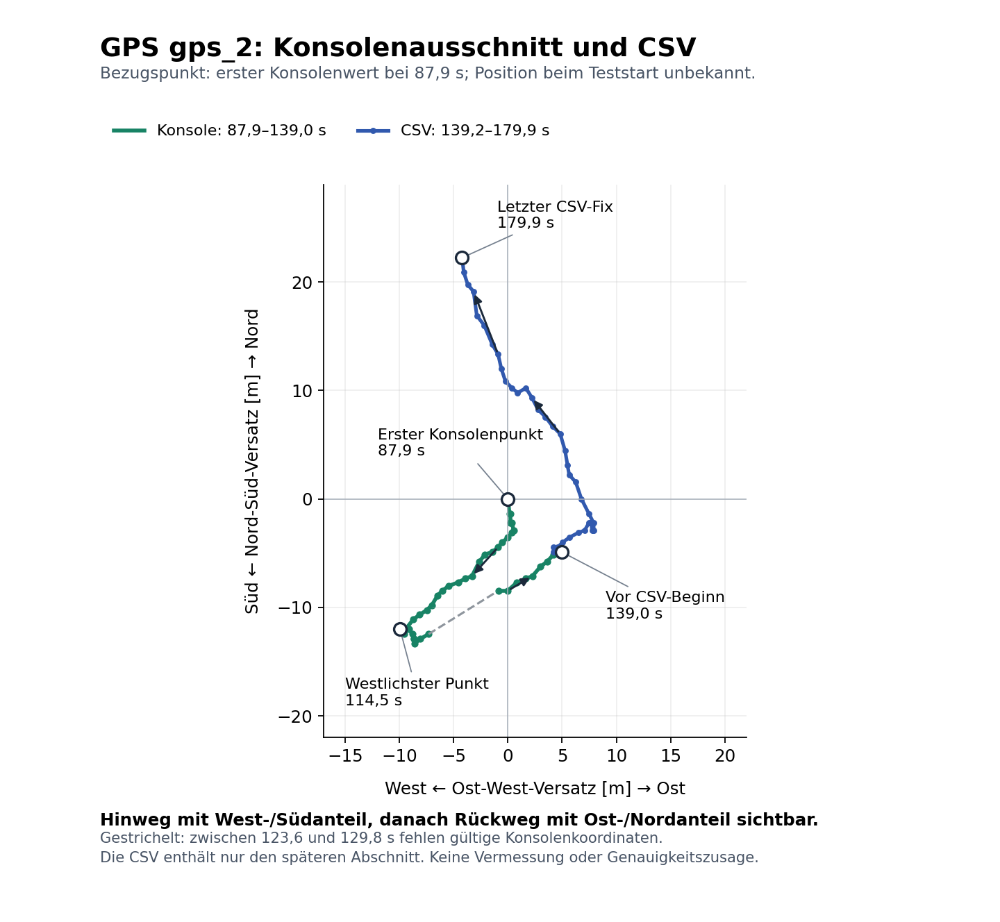

# S2-Wiederholung gps_2 — Fix und Bewegungsreaktion bestaetigt

Auswertung 2026-10-20, codex/gps-baro-bringup. Dateien unveraendert:
[gps_2.csv](gps_2.csv), [gps_2.json](gps_2.json). Der Besitzer bestaetigt
Bewegung etwa nach Westen und Rueckkehr vor dem gespeicherten CSV-Ausschnitt.
Sein nachgereichter [Konsolenauszug](gps_2_konsole.txt) ergaenzt den frueheren Weg.
S2 ist aus Logs und Besitzerbeobachtung **funktional bestanden**. Absolute
Positionsgenauigkeit und eine vermessene Rueckkehrdistanz sind damit nicht belegt.

## Verifizierter Empfang und Vergleich

| Merkmal | Erster Lauf gps | Wiederholung gps_2 |
| --- | --- | --- |
| Dauer | 180.225 s | 180.002 s |
| Erster aufgezeichneter gemeinsamer Fix | keiner | 74.820 s |
| Gueltige Fix-Samples im ganzen Lauf | 0 | 453 |
| NMEA-Saetze / GGA-RMC-Updates | 908 / 360 | 1883 / 362 |
| Pruefsummen-/Parserfehler | 0 / 0 | 0 / 0 |
| Pollpausen | 314 | 0 |
| work Mittel / Maximum | 12.758 / 423.331 ms | 2.090 / 33.329 ms |
| work >50 ms | 324 | 0 |
| period Mittel / Maximum | 21.774 / 423.541 ms | 10.232 / 33.543 ms |
| Exceptions / Abschluss | keine / sauber | keine / sauber |

Neue Zaehler: 106 gueltige GGA-Fixsaetze, 106 gueltige RMC-Fixsaetze,
maximal 12 benutzte Satelliten. Das ist deutlich mit der UART-Korrektur
vereinbar; konkrete MCU-Quelldateien sind nicht vollstaendig archiviert.
Das JSON meldet noch Testversion **0.1.0**, enthaelt aber die neuen Zaehler.
Moegliche alte config.py oder importierte RAM-Konfiguration; genaue Ursache
nicht nachgewiesen. Fuer S3 alle Sensormodule konsistent aktualisieren und
Soft-Reboot. Keine Neukalibrierung noetig. Neuer Quellstand ist inzwischen 0.2.0.

CSV: 886 erzeugte, nur letzte 200 Zeilen erhalten (139186..179921 ms,
40.735 s), darin 42 unterschiedliche Positionszeiten. 178 Zeilen haben einen
gemeinsamen Fix; in 22 sind GGA und RMC einzeln gueltig/frisch, aber noch nicht
derselben UTC-Epoche zugeordnet. Das sind im Ausschnitt keine nachgewiesenen
Empfangsausfaelle. Satelliten durchgehend 12, HDOP 0.92..1.01; HDOP ist keine
Genauigkeit in Metern. Datenalter jeweils <1 s, Geschwindigkeit 0.01..1.66 m/s.
course_usable bleibt korrekt 0 unter der 2-m/s-Schwelle. Hoehe 491.2..495.5 m
ueber MSL ist kein unabhaengiger Nachweis einer realen Hoehenaenderung.

## Wegabgleich mit der nachgereichten Konsole

Der CSV-Ring beginnt erst nach dem laut Besitzer abgeschlossenen Hin-/Rueckweg.
Sein erster Punkt ist daher **nicht** der Ausgangspunkt des ganzen Versuchs.
Allein aus dem CSV: zuerst kleine Verschiebungen, danach grob nordnordwestlich;
erster zu letztem Fix ca. 9.2 m West und 27.1 m Nord. Daraus konnte der
fruehere Hin-/Rueckweg nicht beurteilt werden.

Die 57 uebermittelten Konsolenzeilen (87.906..145.125 s) enthalten 52 gueltige
Positionen. Lokale Meternaeherung mit R=6371000 m und cos(Breite):

- 87.906 bis 114.479 s: ca. **9.9 m West und 12.0 m Sued**, also ein
  Hinweg mit deutlichem Westanteil, genauer suedwestlich.
- 114.479 bis 138.986 s: ca. **14.9 m Ost und 7.1 m Nord**, klarer
  Richtungswechsel zurueck nach Osten/Nordosten. Besitzer bestaetigt Rueckkehr
  vor den letzten 40 s; der genaue Rueckkehrzeitpunkt wurde nicht genannt.
  138.986 s ist hier der letzte Konsolenpunkt vor dem CSV-Beginn, kein
  unabhaengig bestimmter Rueckkehrzeitpunkt. Bewegung/Richtungswechsel plausibel.
- Die erste uebermittelte Konsolenposition liegt ca. 7 m vom Punkt bei
  138.986 s entfernt. Sie muss aber nicht der wirkliche Ausgangspunkt sein;
  die ersten Fixwerte ab 74.820 s fehlen im Auszug. Daraus keine GPS-
  Genauigkeit oder fehlgeschlagene physische Rueckkehr ableiten.
- Bei 124.675..128.765 s gibt die Konsole fix=0 und keine Koordinaten aus.
  Die Alterswerte sind mit dem zeitversetzten Eintreffen neuer RMC/GGA-Saetze
  vereinbar; die Einzelgueltigkeitsflags fehlen im Konsolenauszug. Diese Luecke
  im Diagramm markieren, nicht als gemessenen kontinuierlichen Weg behandeln.

[SVG zum Export](gps_2_weg.svg). Pfeile zeigen die Reihenfolge der Messpunkte,
keine Flugzeugausrichtung. Keine Onlinekarte oder externe Ortsabfrage benutzt.

## Pruefungen und Fingerprints

Hostpruefung: CSV-Schema/Zeilenanzahl, steigende Zeit, Gueltigkeits-/Leerwerte,
Datenalter, Geschwindigkeitsfreigabe und Anfangs-NMEA-Pruefsummen konsistent.
Konsole als Besitzertranskript gespeichert, nicht als originale MCU-Datei.
Der CSV-Ring ist keine Aufzeichnung des ganzen Laufes; JSON deckt Laufaggregate ab.

| Datei | SHA-256 |
| --- | --- |
| gps_2.csv | 98a00e8bed5b464616938f08be4cefeb8721cc93c4bb32f29464992146a51fb8 |
| gps_2.json | 0381e9cf2b25073d42309b9f17a14da8e57b23037334e3d9403d3ddb9364ee01 |
| gps_2_konsole.txt | f7ed104d00fbbbe1ffea2a550f0cb3a1c58510334ecea13ba7404938798933ac |

## Korrektur der Aufzeichnung fuer folgende Versuche

Die alte 200-Zeilen-Grenze war ein **RAM-Ring**, unabhaengig von freiem Flash.
Dateien zu loeschen aendert diese Grenze nicht. Neue Version **0.2.0** reserviert
vor Hardwarestart fuer die gesamte angeforderte Dauer einen kompakten Puffer:
83 Bytes je Sample, standardmaessig 2 Hz. Fuer 180 s sind 29963 Bytes, fuer
300 s 49883 Bytes reserviert (je eine Reservezeile). Alle erfassten Samples
bleiben erhalten, CSV/JSON werden weiterhin erst nach Stop gespeichert.

Maximal 65536 Pufferbytes und 32768 freie RAM-Bytes als geplante Reserve;
bei zu grossem Lauf oder zu wenig gemeldetem RAM Abbruch **vor Hardwarestart**,
keine still verringerte Rate/alte ueberschriebene Daten. CSV behaelt 25 Spalten,
UTC wird auf Millisekunden formatiert. JSON-Schema 2 dokumentiert Speichermenge,
Kapazitaet und log.all_samples_retained. Diese Aussage gilt fuer erfasste Samples,
nicht fuer einen vollendeten Versuch bei Ctrl+C/Fehler oder lueckenlose GPS-Fixes.
Stromverlust verliert weiterhin RAM-Daten; dies ist noch kein MANUAL-Fluglogger.

129 Hosttests bestanden, darunter voller simulierter Drei-Minuten-Export,
Leerwert-/Koordinaten-/Zeit-Roundtrip, Ueberlauf ohne Ueberschreiben, RAM-/Groessen-
ablehnung vor Hardwarestart und Export nach UART-Abschaltung. Die neue
Speicherfunktion wurde in gps_2 noch **nicht** physisch getestet.

## Naechster Schritt

S2 nicht allein wegen des alten Ringpuffers wiederholen. Jetzt **S3**:
die sechs Sensormodule aktualisieren, calibration.json behalten, Soft-Reboot,
auf Sensor-Test 0.2.0 achten. Mit ausgeschaltetem BEC/Receiver/Servos draussen
`sensor_test.run('both', duration_s=180)` ausfuehren. Nach Fix etwa 10..20 m
gehen und zurueck; Barometer einmal langsam anheben/absenken. Beide Dateien
getrennt unter einem S3-Ordner sichern. Danach gemeinsam Datenqualitaet,
Vollstaendigkeit und Zusatzlast fuer die spaetere MANUAL-Integration bewerten.
